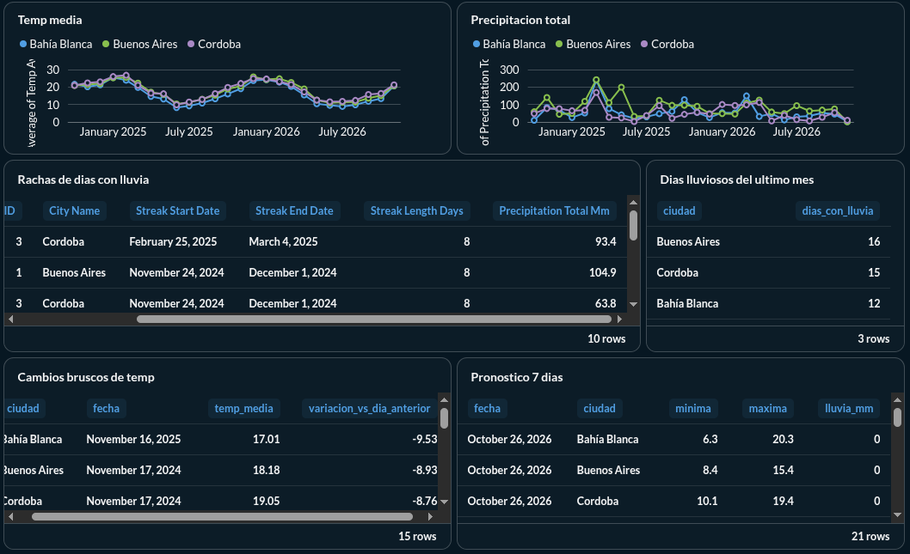
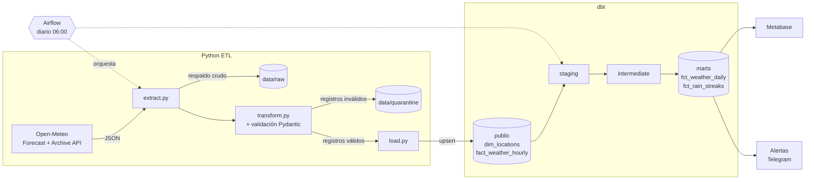

# Weather ETL Pipeline


Pipeline de datos meteorológicos de punta a punta: extrae datos horarios de la API pública de [Open-Meteo](https://open-meteo.com/) (histórico observado y pronóstico), los valida contra un contrato de datos, los carga en PostgreSQL y los transforma con **dbt** en un modelo analítico listo para consumir, visualizado en **Metabase**. Todo se ejecuta a diario orquestado con **Airflow**, con reintentos y alertas por Telegram.



## Arquitectura



| Capa | Responsabilidad |
|---|---|
| **Extract** | Llama a la API por cada ciudad de `dim_locations` (siempre en UTC) y guarda el JSON crudo para poder reprocesarlo. |
| **Transform** | Desanida las listas paralelas de `hourly` y valida cada fila con Pydantic. |
| **Load** | Bulk upsert con `execute_values` + `ON CONFLICT`: el pipeline es **idempotente**. |
| **dbt** | Convierte las mediciones horarias en métricas diarias y rachas de lluvia (capa gold). |
| **Airflow** | Ejecuta todo a diario, reintenta lo que falla y avisa por Telegram. |

## Orquestación (Airflow)

El DAG [`weather_pipeline`](airflow/dags/weather_pipeline.py) corre todos los días a las 06:00 (hora de Argentina):

```
list_locations → ingest_city × N ciudades → dbt_build → check_weather_alerts
```

- **Una tarea por ciudad** (*dynamic task mapping*): las ciudades se procesan en paralelo y, si la API falla para una, Airflow reintenta solo esa (2 reintentos, cada 5 minutos). Agregar una ciudad a `dim_locations` agrega una tarea sin tocar el DAG.
- **dbt_build** ejecuta primero `dbt source freshness`: si la ingesta no cargó datos nuevos, falla antes de reconstruir los modelos. Si alguna ciudad falló, dbt no se ejecuta y el dashboard no muestra datos a medio cargar.
- **check_weather_alerts** lee los próximos 3 días de `fct_weather_daily` y avisa por Telegram de lluvia intensa (≥ 20 mm), calor (≥ 35 °C) o heladas (≤ 0 °C).
- **Alertas de fallo**: si una tarea agota sus reintentos, se envía un mensaje por Telegram.
- La lógica vive en `main.py` y `src/`; el DAG solo la orquesta. Por eso el pipeline se puede ejecutar y testear sin Airflow.
- CI construye la imagen de Airflow y verifica que el DAG carga sin errores.

<details>
<summary>Configurar las alertas de Telegram (opcional)</summary>

1. En Telegram, habla con [@BotFather](https://t.me/BotFather), envía `/newbot` y copia el token.
2. Envía cualquier mensaje a tu bot y abre `https://api.telegram.org/bot<TOKEN>/getUpdates` para ver tu `chat.id`.
3. Agrega `TELEGRAM_BOT_TOKEN` y `TELEGRAM_CHAT_ID` a `.env` y reinicia Airflow: `docker compose up -d airflow`.

Sin estas variables, las alertas solo se registran en los logs.
</details>

## Datos observados vs. pronóstico

El pipeline tiene dos modos que escriben en la misma tabla, diferenciados por la columna `data_source`:

- **Pronóstico** (`python main.py`): últimos 7 días y próximos 7 días desde la Forecast API. Pensado para ejecutarse a diario.
- **Histórico** (`python main.py --backfill`): datos observados (reanálisis ERA5) desde la Archive API. Por defecto carga 2 años, o el rango indicado con `--start-date` / `--end-date`.

La regla de carga garantiza que **un dato observado nunca se reemplaza por un pronóstico**, pero sí al revés: cuando la Archive API publica el dato real de un día, sobrescribe el pronóstico que había.

## Calidad de datos

La validación ocurre en dos niveles:

1. **Estructural (lote completo)**: si la API omite o renombra un campo, devuelve listas de distinto largo o una zona horaria distinta de UTC, se lanza `SchemaError` y esa ciudad no se carga. El resto de las ciudades continúa.
2. **Por registro**: cada fila se valida contra [`WeatherRecord`](src/schemas.py) (humedad 0–100 %, temperatura entre -90 y 60 °C, precipitación y viento no negativos, al menos una medición no nula). Las filas inválidas van a `data/quarantine/*.jsonl` con el detalle del error, sin bloquear la carga de las válidas.

Además, `fact_weather_hourly` tiene restricciones `CHECK` con los mismos rangos como segunda línea de defensa, y dbt agrega tests sobre los modelos analíticos.

## Capa analítica (dbt)

El proyecto dbt vive en [`analytics/`](analytics/) y sigue la estructura estándar por capas:

| Modelo | Capa | Descripción |
|---|---|---|
| `stg_weather__hourly`, `stg_weather__locations` | staging | 1:1 con las tablas fuente. |
| `int_weather__hourly_local` | intermediate | Convierte cada hora UTC a la hora local de su ciudad, para que los días se agreguen correctamente. |
| `fct_weather_daily` | marts | Temperatura media/mín./máx., precipitación total, humedad, viento máximo y **variación de temperatura respecto al día anterior** (`LAG()`). Marca días lluviosos (≥ 1 mm, criterio OMM) y días incompletos. |
| `fct_rain_streaks` | marts | **Rachas de días consecutivos con lluvia**, calculadas con la técnica *gaps and islands*. |
| `dim_locations` | marts | Dimensión de ciudades. |

Tests incluidos:
- **Tests de datos**: unicidad, no nulos, integridad referencial y valores aceptados, más tests propios ([`analytics/tests/`](analytics/tests/)): mín. ≤ media ≤ máx., y que dos rachas nunca sean contiguas.
- **Tests unitarios de dbt**: verifican la lógica de `LAG()` (incluido el caso de días faltantes) y de detección de rachas con datos de entrada simulados, sin depender de los datos reales.
- **Frescura de la fuente**: `dbt source freshness` alerta si no se cargan datos nuevos en 24 h.

Ejemplo de consulta sobre la capa gold:

```sql
-- Rachas de lluvia más largas por ciudad
select city_name, streak_start_date, streak_end_date, streak_length_days, precipitation_total_mm
from marts.fct_rain_streaks
order by streak_length_days desc
limit 5;
```

## Dashboard (Metabase)

Metabase se levanta junto con PostgreSQL en `docker compose` y lee **solo** el schema `marts`:

- Se conecta con el usuario `metabase_reader`, de solo lectura ([`sql/init_metabase.sql`](sql/init_metabase.sql)). dbt le otorga `SELECT` sobre los modelos de `marts` en cada build (config `grants`), por lo que no puede ver las tablas crudas ni las capas intermedias.
- Metabase guarda sus propios metadatos (usuarios, preguntas, dashboards) en una base `metabase` separada de los datos.
- Las consultas SQL del dashboard están versionadas en [`dashboards/metabase_queries.sql`](dashboards/metabase_queries.sql).

## Ejecución

Requisitos: Docker y [uv](https://docs.astral.sh/uv/).

```bash
cp .env.example .env
docker compose up -d                  # PostgreSQL, Metabase (localhost:3000) y Airflow (localhost:8080)
uv sync                               # dependencias (incluye dbt)

uv run python main.py --backfill      # carga inicial: 2 años de histórico
uv run python main.py                 # pronóstico (Airflow lo ejecuta a diario)

cd analytics
uv run dbt build                      # modelos + tests
uv run dbt docs generate && uv run dbt docs serve   # documentación y linaje
```

El pipeline termina con código de salida `1` si alguna ciudad falla, para que un orquestador (cron, Airflow, CI) pueda detectarlo.

## Tests y CI

```bash
uv run pytest                         # todos los tests de Python
uv run pytest -m "not integration"    # solo unitarios (sin base de datos)
uv run ruff check . && uv run ruff format --check .
```

- **Unitarios**: la API se simula con `unittest.mock` y un JSON sintético ([fixture](tests/fixtures/open_meteo_sample.json)); cubren valores fuera de rango, nulos, fechas mal formadas, campos renombrados y listas vacías.
- **Integración**: verifican contra un PostgreSQL real que la carga sea idempotente y que un pronóstico no pise un dato observado (se omiten si no hay base disponible).
- **GitHub Actions** ejecuta en cada push a `main`: lint, tests de Python y `dbt build` con un PostgreSQL efímero como *service container*, y la validación de los DAGs de Airflow.

## Estructura

```
├── main.py                     # flujo ETL (pronóstico o backfill), también usado por Airflow
├── airflow/
│   ├── Dockerfile              # Airflow + dependencias del pipeline + dbt
│   └── dags/weather_pipeline.py
├── src/
│   ├── extract.py
│   ├── transform.py
│   ├── load.py
│   ├── schemas.py              # contrato de datos (Pydantic)
│   ├── alerts.py               # alertas por Telegram
│   └── utils.py
├── sql/init_db.sql             # modelo dimensional
├── analytics/                  # proyecto dbt
│   ├── models/
│   │   ├── staging/
│   │   ├── intermediate/
│   │   └── marts/
│   └── tests/
├── tests/                      # tests de Python
└── .github/workflows/ci.yml
```
