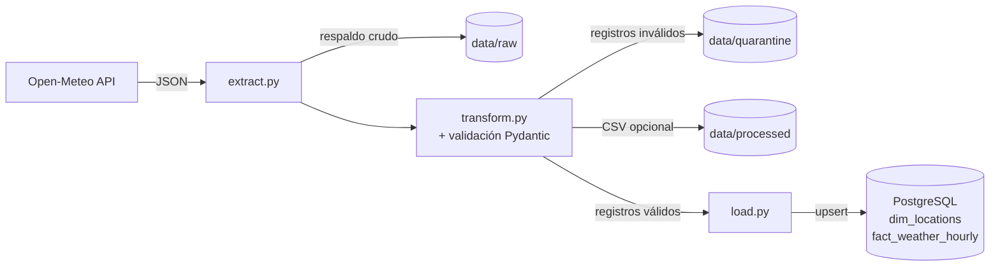

# Weather ETL Pipeline


Pipeline ETL batch que extrae pronósticos meteorológicos horarios de la API pública de [Open-Meteo](https://open-meteo.com/), los valida contra un contrato de datos y los carga en un modelo dimensional en PostgreSQL.

## Arquitectura



| Capa | Responsabilidad |
|---|---|
| **Extract** | Llama a la API por cada ciudad de `dim_locations` (en UTC) y guarda el JSON crudo para poder reprocesarlo. |
| **Transform** | Desanida las listas paralelas de `hourly` y valida cada fila con Pydantic. |
| **Load** | Bulk upsert con `execute_values` + `ON CONFLICT`: el pipeline es **idempotente**. |

## Calidad de datos

La validación ocurre en dos niveles:

1. **Estructural (lote completo)**: si la API omite o renombra un campo, devuelve listas de distinto largo o una zona horaria distinta de UTC, se lanza `SchemaError` y esa ciudad no se carga. El resto de las ciudades continúa.
2. **Por registro**: cada fila se valida contra [`WeatherRecord`](src/schemas.py) (humedad 0–100 %, temperatura entre -90 y 60 °C, precipitación y viento no negativos, al menos una medición no nula). Las filas inválidas van a `data/quarantine/*.jsonl` con el detalle del error, sin bloquear la carga de las válidas.

Además, la tabla `fact_weather_hourly` tiene restricciones `CHECK` con los mismos rangos como segunda línea de defensa.

## Ejecución

Requisitos: Docker y [uv](https://docs.astral.sh/uv/).

```bash
cp .env.example .env
docker compose up -d          # PostgreSQL + esquema inicial
uv sync                       # dependencias
uv run python main.py         # ejecuta el pipeline
```

El proceso termina con código de salida `1` si alguna ciudad falla, para que un orquestador (cron, Airflow, CI) pueda detectarlo.

## Tests y CI

```bash
uv run pytest                 # todos los tests
uv run pytest -m "not integration"   # solo unitarios (sin base de datos)
uv run ruff check . && uv run ruff format --check .
```

- **Unitarios**: la API se simula con `unittest.mock` y un JSON sintético ([fixture](tests/fixtures/open_meteo_sample.json)); cubren valores fuera de rango, nulos, fechas mal formadas, campos renombrados y listas vacías.
- **Integración**: verifican contra un PostgreSQL real que la carga sea idempotente (se omiten si no hay base disponible).
- **GitHub Actions** ejecuta lint y tests en cada push a `main`, con un PostgreSQL efímero como *service container*.

## Estructura

```
├── main.py                 # orquesta el flujo ETL
├── src/
│   ├── extract.py
│   ├── transform.py
│   ├── load.py
│   ├── schemas.py          # contrato de datos (Pydantic)
│   └── utils.py
├── sql/init_db.sql         # modelo dimensional
├── tests/
└── .github/workflows/ci.yml
```
